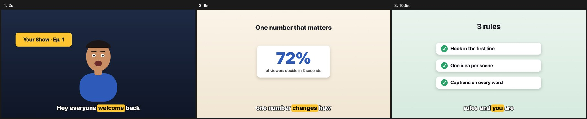

# Daksh AI — animated explainer videos with Claude Code

A [Claude Code](https://claude.com/claude-code) skill by **Daksh AI** that turns a voice recording
into an animated, captioned explainer / podcast-style video: a cartoon host with lip-sync,
explainer cards that pop in on the right word, and word-by-word captions — all drawn in code
and rendered to MP4 with [HyperFrames](https://hyperframes.heygen.com).



## 46 more video skills (`skills/`)

Every skill from [aanshai.vercel.app/skills](https://aanshai.vercel.app/skills) is here as a ready `SKILL.md`:
anime episodes, Madhubani stories, lyric videos, podcast explainers, reel edits, motion effects and looks.

**Install all of them** (Claude Code picks up every folder in `~/.claude/skills`):
```bash
git clone https://github.com/manikk90/Ai-Animation.git
cp -r Ai-Animation/skills/* ~/.claude/skills/
```
Or install just one, for example: `cp -r Ai-Animation/skills/madhubani-kahani ~/.claude/skills/`.
To keep them inside one project instead, copy them into that project's `.claude/skills/` folder.

**Use one:** start `claude`, type `/` and the skill name, and attach or name your file:
```
/madhubani-kahani make a video from kahani.mp3
```

| Group | Skill | What it makes | You give |
|---|---|---|---|
| Animated videos | [`/anime-reel`](skills/anime-reel/SKILL.md) | Anime reel | a script and the voice MP3s for each line |
| Animated videos | [`/madhubani-kahani`](skills/madhubani-kahani/SKILL.md) | Madhubani kahani | a Hindi story voiceover MP3 |
| Animated videos | [`/katha-video`](skills/katha-video/SKILL.md) | Katha video | a 60–90 second pravachan MP3 |
| Animated videos | [`/lyric-video`](skills/lyric-video/SKILL.md) | Crayon lyric video | a song MP3 and its lyrics, one sung line per row |
| Animated videos | [`/watercolor-map`](skills/watercolor-map/SKILL.md) | Watercolor map journey | two places, like “Bengaluru → California” |
| Animated videos | [`/news-report`](skills/news-report/SKILL.md) | Tech news report | a news topic or 2–3 article links |
| Animated videos | [`/talking-head-edit`](skills/talking-head-edit/SKILL.md) | Talking-head edit | a 9:16 talking-head clip |
| Animated videos | [`/podcast-explainer`](skills/podcast-explainer/SKILL.md) | Podcast explainer | a 45–90 second podcast clip (MP3) |
| Animated videos | [`/hindi-lyric-video`](skills/hindi-lyric-video/SKILL.md) | Hindi lyric video | a Hindi song MP3 and its lyrics in Devanagari, one line per row |
| Animated videos | [`/pusho-reel`](skills/pusho-reel/SKILL.md) | Pusho reel | a Puneet Superstar audio clip (MP3) |
| Animated videos | [`/titan-anime`](skills/titan-anime/SKILL.md) | Titan anime episode | a script and the voice MP3s for each line |
| Animated videos | [`/personal-explainer`](skills/personal-explainer/SKILL.md) | Personal explainer | your voiceover MP3, the topic, and any source links |
| Animated videos | [`/sketch-music-video`](skills/sketch-music-video/SKILL.md) | Sketch music video | a song MP3 and its lyrics, one sung line per row |
| Animated videos | [`/kinetic-lyrics`](skills/kinetic-lyrics/SKILL.md) | Kinetic lyrics | a song MP3 and its lyrics |
| Animated videos | [`/latent-reel`](skills/latent-reel/SKILL.md) | Latent-style roast reel | a show clip (MP3) with the guest and host talking |
| Animated videos | [`/comic-reel`](skills/comic-reel/SKILL.md) | Comic book reel | the scene's dialogue audio (MP3) |
| Animated videos | [`/sketch-to-motion`](skills/sketch-to-motion/SKILL.md) | Sketch to motion graphic | 8–10 photos of your sketches, plus your product photos and stock clips |
| Animated videos | [`/blueprint-explainer`](skills/blueprint-explainer/SKILL.md) | Blueprint explainer | a long voiceover MP3 (3–10 minutes) and the facts or numbers it covers |
| Reel formats | [`/personal-short-form-reels`](skills/personal-short-form-reels/SKILL.md) | Personal short-form reel | a 9:16 talking-head clip |
| Reel formats | [`/personal-broll-library`](skills/personal-broll-library/SKILL.md) | Personal B-roll library | a folder of my B-roll clips |
| Reel formats | [`/depth-ui-reel`](skills/depth-ui-reel/SKILL.md) | Depth UI reel | a 9:16 talking-head clip |
| Reel formats | [`/youtube-clips`](skills/youtube-clips/SKILL.md) | YouTube clips | a long 16:9 video or a YouTube link |
| Reel formats | [`/educational-youtube-editor`](skills/educational-youtube-editor/SKILL.md) | Educational YouTube editor | a long 16:9 lesson recording |
| Reel formats | [`/ranking-format`](skills/ranking-format/SKILL.md) | Ranking / tier list | a 9:16 talking-head clip |
| Reel formats | [`/business-short-form-reels`](skills/business-short-form-reels/SKILL.md) | Business short-form reel | a 9:16 talking-head clip |
| Motion effects | [`/match-cut`](skills/match-cut/SKILL.md) | Match cut | a 9:16 talking-head clip |
| Motion effects | [`/shutter-stack`](skills/shutter-stack/SKILL.md) | Shutter stack | a 9:16 talking-head clip |
| Motion effects | [`/led-matrix-text`](skills/led-matrix-text/SKILL.md) | LED matrix text | a 9:16 talking-head clip |
| Motion effects | [`/glass-stat-card`](skills/glass-stat-card/SKILL.md) | Glass stat card | a 9:16 talking-head clip |
| Motion effects | [`/particle-chart`](skills/particle-chart/SKILL.md) | Particle chart | a 9:16 talking-head clip |
| Motion effects | [`/particle-text`](skills/particle-text/SKILL.md) | Particle text | a 9:16 talking-head clip |
| Motion effects | [`/price-tag-zoom`](skills/price-tag-zoom/SKILL.md) | Price-tag zoom | a 9:16 talking-head clip |
| Edit styles | [`/podcast-reel-edit`](skills/podcast-reel-edit/SKILL.md) | Podcast reel edit | a 9:16 talking-head clip |
| Edit styles | [`/dark-red-timeline-motion-graphics`](skills/dark-red-timeline-motion-graphics/SKILL.md) | Dark red timeline | a 9:16 talking-head clip |
| Edit styles | [`/instagram-ui-hinglish`](skills/instagram-ui-hinglish/SKILL.md) | Instagram UI (Hinglish) | a 9:16 talking-head clip |
| Edit styles | [`/hindi-pastel-reel-edit`](skills/hindi-pastel-reel-edit/SKILL.md) | Hindi pastel reel | a 9:16 talking-head clip |
| Edit styles | [`/kinetic-talking-head-edit`](skills/kinetic-talking-head-edit/SKILL.md) | Kinetic talking head | a 9:16 talking-head clip |
| Edit styles | [`/red-kinetic-collage-edit`](skills/red-kinetic-collage-edit/SKILL.md) | Red kinetic collage | a 9:16 talking-head clip |
| Edit styles | [`/iphone-style-by-daksh-ai`](skills/iphone-style-by-daksh-ai/SKILL.md) | iPhone style | a 9:16 talking-head clip |
| Looks | [`/rgb-glitch-live`](skills/rgb-glitch-live/SKILL.md) | RGB glitch live | a 9:16 talking-head clip |
| Looks | [`/magazine-cover`](skills/magazine-cover/SKILL.md) | Magazine cover | a 9:16 talking-head clip |
| Looks | [`/comic-halftone`](skills/comic-halftone/SKILL.md) | Comic halftone | a 9:16 talking-head clip |
| Looks | [`/breaking-news`](skills/breaking-news/SKILL.md) | Breaking news | a 9:16 talking-head clip |
| Looks | [`/neon-outline`](skills/neon-outline/SKILL.md) | Neon outline | a 9:16 talking-head clip |
| Looks | [`/cinema-scope`](skills/cinema-scope/SKILL.md) | Cinema scope | a 9:16 talking-head clip |
| Looks | [`/triptych-timecode`](skills/triptych-timecode/SKILL.md) | Triptych timecode | three clips |

## Quick start (Mac)

### 1. Install the tools (one time)
```bash
brew install node ffmpeg whisper-cpp
pip3 install numpy librosa
```
You also need [Claude Code](https://claude.com/claude-code) installed and logged in.

### 2. Download a whisper model (one time)
Whisper turns speech into word timings for the captions.
```bash
mkdir -p ~/models
curl -L -o ~/models/ggml-large-v3.bin \
  https://huggingface.co/ggerganov/whisper.cpp/resolve/main/ggml-large-v3.bin
```
`ggml-large-v3.bin` (~3 GB) is the most accurate, and the best choice for Hindi.
For a smaller, faster download use `ggml-base.bin` (~150 MB) instead.

### 3. Add the skill to Claude Code
```bash
git clone https://github.com/<your-username>/Ai-Animation.git
cp -r Ai-Animation/daksh-ai ~/.claude/skills/
```

### 4. Make a video
Open a terminal and start Claude Code:
```bash
claude
```
Then ask for your video, for example:
```
/daksh-ai make a podcast-style explainer video from ~/Downloads/voice.mp3.
My whisper model is at ~/models/ggml-large-v3.bin.
Here's the script: <paste your script>
```
Claude will set up the project, time every word, write the scenes, check still frames,
and render the MP4 into the project's `renders/` folder. A few minutes of audio
can take 15–30 minutes to render.

### 5. Ask for changes in plain words
- "Make the captions bigger"
- "Change the host's shirt to red and give him glasses"
- "When I say ₹50,000, show a money card with that number"
- "Make a smaller copy for WhatsApp"

## Tips
- **Give the exact script.** Captions then use your wording instead of whisper's guesses.
- **Set the language** for non-English audio, e.g. "the audio is in Hindi".
- **Vertical video:** ask for 9:16 / 1080×1920 for Reels and Shorts.
- **Watch the final video once** before posting; caption timing can drift on long audio.

## Windows / Linux
The skill itself works anywhere Claude Code runs. Install the same tools another way:
- **Windows:** use [WSL](https://learn.microsoft.com/windows/wsl/install) and follow the Linux steps.
- **Linux:** `sudo apt install nodejs ffmpeg python3-pip`, `pip3 install numpy librosa`, and build
  [whisper.cpp](https://github.com/ggerganov/whisper.cpp), which provides `whisper-cli`.

## Troubleshooting
| Problem | Fix |
|---|---|
| `whisper-cli: command not found` | `brew install whisper-cpp` |
| `No module named librosa` | `pip3 install numpy librosa` |
| Captions are out of sync | Give Claude the exact script and ask it to re-check the timing around the bad spot |
| Video has no sound | Make sure the `<audio>` element in `index.html` points at your file |
| Render is slow | Normal: rendering uses a lot of CPU. Close other apps and run one render at a time |

## What's inside
| Path | What |
|---|---|
| `daksh-ai/SKILL.md` | The workflow Claude follows |
| `skills/<name>/SKILL.md` | The 46 video skills from aanshai.vercel.app/skills |
| `daksh-ai/template/` | Starter project: `engine.js` (helpers, simple host, captions, shot runner) + demo `scenes.js` |
| `daksh-ai/tools/transcribe.sh` | Audio → word-level whisper JSON |
| `daksh-ai/tools/align.py` | Aligns your exact script to whisper timings |
| `daksh-ai/tools/mouth.py` | Audio → lip-sync envelope |
| `daksh-ai/harness.js` | Runs every frame on a fake canvas to catch crashes before rendering |

Try the demo without any audio (opens a preview in your browser):
```bash
cd daksh-ai/template && npx --yes hyperframes@0.8.143 preview
```

## Want more?
This is the starter edition. The custom characters, studio sets, icon libraries and multi-language
caption pipeline used in Daksh AI client videos are not included — reach out to Daksh AI for custom work.

## License
MIT for the code in this repo. `template/assets/gsap.min.js` is GSAP, under the
[GreenSock standard license](https://gsap.com/standard-license).
